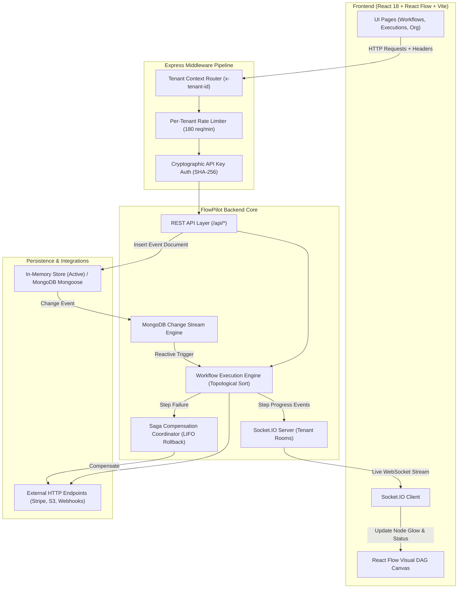

# FlowPilot — Multi-Tenant Distributed Workflow & Saga Orchestration Engine

[](https://nodejs.org/)
[](https://react.dev/)
[](https://vitejs.dev/)
[](https://expressjs.com/)
[](https://socket.io/)
[](backend/test/)

**FlowPilot** is a resilient, multi-tenant distributed workflow and Saga orchestration engine designed for mission-critical enterprise automation. It combines a visual Directed Acyclic Graph (DAG) builder with an asynchronous execution state machine, real HTTP dispatching, dynamic condition branching, distributed Saga compensation rollback, real-time WebSocket progress streaming, and a reactive MongoDB Change Stream trigger engine.

---

## 🌟 Key Features & Architectural Highlights

### 1. Multi-Tenant Isolation & Workspace Management
- **Tenant Context Routing:** Strict isolation via the `x-tenant-id` request header. Workflows, executions, and keys are partitioned per tenant.
- **Interactive Workspace Switcher:** Switch seamlessly between enterprise workspaces (*Acme Ltd.*, *Globex Corp.*, *Stark Industries*, or custom tenants) directly in the navigation UI.
- **Tenant-Scoped Rate Limiting:** High-frequency protection enforcing a sliding window of **180 requests/minute per tenant** rather than a blunt global IP limit.

### 2. Cryptographic API Key Security
- **One-Way Hashing:** High-entropy API keys (`fp_...`) are cryptographically hashed at rest using **SHA-256 with a server-side pepper**.
- **Least-Privilege Exposure:** Plaintext keys are presented to users **only once** upon creation.
- **Active 401 Enforcement:** Requests with missing, expired, revoked, or cross-tenant API keys are strictly rejected with HTTP `401 Unauthorized`.
- **Self-Healing Client:** Frontend API layer automatically catches stale keys from past sessions, clears them from `localStorage`, and recovers without user interruption.

### 3. Visual DAG Builder & Structural Validation
- **React Flow Canvas:** Interactive drag-and-drop workflow builder supporting triggers, actions, conditionals, and compensation nodes.
- **Topological DAG Validation:** Backend graph analysis validates graphs before execution:
  - Detects infinite cycles and recursive loops via Depth-First Search (DFS).
  - Flags orphaned or unreachable nodes disconnected from triggers.
  - Validates missing or duplicate step identifiers.

### 4. Resilient Execution Engine
- **Real External HTTP Dispatch:** Executes real HTTP/REST API calls using native `fetch()` with custom HTTP methods (`GET`, `POST`, `PUT`, `DELETE`), headers, payloads, and request timeouts (`AbortSignal.timeout`).
- **Configurable Retries & Backoff:** Transient network and HTTP errors automatically trigger bounded retries with exponential backoff.
- **Dynamic Condition Branching:** Evaluates dynamic condition rules (`==`, `!=`, `>`, `<`, `contains`) against workflow context and prior step responses to route execution paths.

### 5. Saga Distributed Compensation Rollback
- **Distributed Consistency:** When a downstream step encounters an unrecoverable failure, FlowPilot executes compensating actions to reverse previously completed steps.
- **Strict Reverse Order (LIFO):** Compensations run in exact inverse order of completion to prevent data anomalies and orphan charges.
- **Granular Compensation Status:** Distinguishes between successful rollback (`Compensated`) and partial rollback failure (`CompensationFailed`).

### 6. Real-Time WebSocket Execution Monitoring
- **Socket.IO Streaming:** Live execution events stream directly from the engine to the browser over tenant-scoped rooms (`tenant:<id>`).
- **Visual Canvas Pulse:** Canvas nodes glow and animate in real time:
  - 🔵 **Blue Pulse:** Step running
  - 🟢 **Green:** Step completed successfully
  - 🔴 **Red:** Step failed
  - 🟠 **Orange Pulse:** Saga compensation rollback in progress
  - 🟣 **Purple:** Step compensated

### 7. MongoDB Change Stream Reactive Trigger Engine
- **Event-Driven Architecture:** Ingests document mutation events and reactively triggers matching active workflows without manual intervention.
- **Official Specification Payload:** Emits and parses official MongoDB Change Stream format including `_id._data` resume tokens, `operationType: 'insert'`, `clusterTime`, `wallTime`, `ns`, `documentKey`, and `fullDocument`.
- **Offline Adapter Mode:** Operates 100% offline via the Change Stream Adapter pattern, and seamlessly connects to a live MongoDB Replica Set (`collection.watch()`) when configured.

---

## 🏗️ System Architecture



---

## 📂 Project Structure

```
Multi-Tenant-Distributed-Workflow/
├── backend/
│   ├── src/
│   │   ├── models/
│   │   │   ├── ApiKey.js         # Mongoose schema for cryptographic API keys
│   │   │   ├── Execution.js      # Execution run history schema
│   │   │   └── Workflow.js       # Workflow DAG schema
│   │   ├── change-stream.js      # MongoDB Change Stream reactive trigger engine
│   │   ├── server.js             # Express API, Socket.IO server & security pipeline
│   │   └── workflow-engine.js    # DAG traversal, HTTP dispatch, retries, Saga rollback
│   ├── test/
│   │   ├── change-stream.test.js # Unit tests for Change Stream engine
│   │   ├── security-tenancy.test.js # Unit tests for tenant isolation & API keys
│   │   └── workflow-engine.test.js  # Unit tests for DAG sort, HTTP, and Saga rollback
│   └── package.json
├── src/
│   ├── components/
│   │   ├── Layout.jsx            # Shell with interactive workspace switcher
│   │   └── UI.jsx                # Reusable UI atoms (Buttons, Badges, Headers)
│   ├── pages/
│   │   ├── Dashboard.jsx         # System overview & execution statistics
│   │   ├── ExecutionDetails.jsx  # Live timeline, step logs & replay
│   │   ├── Executions.jsx        # Execution run history & export
│   │   ├── Integrations.jsx      # External service connectors
│   │   ├── Organization.jsx      # API key generation & revocation UI
│   │   ├── WorkflowBuilder.jsx   # Visual React Flow DAG canvas with live pulse
│   │   └── Workflows.jsx         # Workflow catalog & lifecycle management
│   ├── services/
│   │   ├── api.js                # Resilient HTTP client with auto-recovery
│   │   └── socket.js             # WebSocket manager for tenant rooms
│   ├── styles.css                # Custom UI styling & glowing pulse animations
│   └── main.jsx                  # Application entry point
├── package.json                  # Root dependencies & scripts
├── vite.config.js                # Vite configuration with API & WebSocket proxies
├── PROJECT_HANDOVER.md           # Comprehensive technical handover & audit report
└── README.md                     # You are here
```

---

## 🚀 Getting Started

### Prerequisites
- **Node.js**: v20.0.0 or higher
- **npm**: v10.0.0 or higher

### 1. Installation

Clone the repository and install dependencies for both the frontend and backend:

```bash
# Clone the repository
git clone https://github.com/thoufiq3003/Multi-Tenant-Distributed-Workflow.git
cd Multi-Tenant-Distributed-Workflow

# Install frontend dependencies
npm install

# Install backend dependencies
cd backend
npm install
cd ..
```

### 2. Running Locally

Start both the backend API (port 4000) and the Vite frontend (port 5173) concurrently with one command:

```bash
npm run dev:full
```

- **Frontend Application:** [http://localhost:5173](http://localhost:5173)
- **Backend Health Check:** [http://localhost:4000/api/health](http://localhost:4000/api/health)

*(Optional)* You can also run them in separate terminal windows:
```bash
# Terminal 1 (Backend)
npm run dev --prefix backend

# Terminal 2 (Frontend)
npm run dev
```

### 3. Pre-Seeded Demo Credentials

For immediate evaluation, the application includes pre-seeded demo API keys for default workspaces:

| Workspace | Tenant ID | Pre-Seeded API Key |
|---|---|---|
| **Acme Ltd.** | `demo-tenant` | `fp_demo_7f8a9b0c1d2e3f4a5b6c7d8e` |
| **Globex Corp.** | `globex-corp` | `fp_globex_7f8a9b0c1d2e3f4a5b6c7d8e` |
| **Stark Industries** | `stark-tech` | `fp_stark_7f8a9b0c1d2e3f4a5b6c7d8e` |

---

## 🧪 Testing & Verification

The project includes an automated test suite executed via the native Node.js test runner (`node --test`).

Run all 17 backend unit tests:
```bash
npm test --prefix backend
```

### Test Coverage Highlights
```
TAP version 13
ok 1 - emitChangeEvent produces official MongoDB Change Stream payload structure
ok 2 - Change Stream reactively triggers matching workflow upon event insert
ok 3 - Change Stream does not trigger workflows of a different tenant
ok 4 - hashApiKey generates deterministic SHA-256 hash
ok 5 - createApiKey persists hashed key and returns plaintext key once
ok 6 - cross-tenant API key isolation: key from Tenant A cannot authenticate Tenant B
ok 7 - revoking API key prevents further authentication
ok 8 - multi-tenant workflow data isolation: tenant records remain separate
ok 9 - seeded default demo key validates for demo-tenant
ok 10 - valid DAG passes validation
ok 11 - cycle is detected
ok 12 - unreachable node is reported
ok 13 - executor follows configured branch and completes
ok 14 - executor retries simulated failure then fails
ok 15 - Saga rollback compensates completed compensatable steps in reverse order
ok 16 - execution reports compensation failure distinctly
ok 17 - executeWorkflow dispatches real HTTP call, records output, and streams progress
1..17
# tests 17 | pass 17 | fail 0
```

Verify frontend production build:
```bash
npm run build
```

---

## 📡 API Reference Overview

All data endpoints require the `x-tenant-id` header (defaults to `demo-tenant`) and validate the `x-api-key` header.

### Workflows
| Method | Endpoint | Description |
|---|---|---|
| `GET` | `/api/workflows` | List all workflows for the active tenant |
| `POST` | `/api/workflows` | Create a new workflow DAG |
| `GET` | `/api/workflows/:id` | Retrieve workflow by ID |
| `PUT` | `/api/workflows/:id` | Update an existing workflow |
| `DELETE` | `/api/workflows/:id` | Delete a workflow |
| `POST` | `/api/workflows/validate` | Validate nodes and edges (cycles, orphans) |
| `PATCH` | `/api/workflows/:id/status` | Update workflow status (`Active` / `Paused`) |

### Executions & Saga Orchestration
| Method | Endpoint | Description |
|---|---|---|
| `GET` | `/api/executions` | List executions for the tenant |
| `GET` | `/api/executions/:id` | Get execution details and step logs |
| `POST` | `/api/workflows/:id/execute` | Execute a workflow with optional payload |
| `POST` | `/api/executions/:id/retry` | Re-run a previous execution |

### API Key Management
| Method | Endpoint | Description |
|---|---|---|
| `GET` | `/api/api-keys` | List active keys (masked preview) |
| `POST` | `/api/api-keys` | Generate a new cryptographically hashed key |
| `DELETE` | `/api/api-keys/:id` | Revoke an API key immediately |

### MongoDB Change Stream & Events
| Method | Endpoint | Description |
|---|---|---|
| `GET` | `/api/events` | List recorded change stream events |
| `POST` | `/api/events` | Ingest an event and reactively fire matching workflows |

---

## 🎯 Step-by-Step Demonstration Guide

Follow these steps to demonstrate the engine's core capabilities:

1. **Workspace Switching (Multi-Tenancy):**
   - Open `http://localhost:5173`.
   - Click the top-left workspace dropdown ("Acme Ltd.") and select **Globex Corp.**
   - Notice the workflow list updates instantly to show Globex's isolated workspace.
2. **Cryptographic API Key Lifecycle:**
   - Navigate to **Organization** (`/organization`) > **API Keys**.
   - Click **Generate New Key**. Copy the revealed key.
   - Click the **Trash** icon to revoke a key and verify immediate access revocation.
3. **Visual DAG Execution & Live WebSocket Streaming:**
   - Go to **Workflows** (`/workflows`) and edit **Order Processing**.
   - Click **"Run test"**.
   - Watch the nodes pulse blue as they execute, turn green upon completion, and stream live progress above the canvas.
4. **Saga Compensation Rollback:**
   - In the workflow builder, edit a node to configure a failing step downstream of a compensatable node.
   - Run the workflow and observe the engine automatically execute backward compensation in reverse order.
5. **MongoDB Change Stream Reactive Trigger:**
   - Open a terminal and emit an event document:
     ```powershell
     Invoke-RestMethod -Uri "http://localhost:4000/api/events" -Method POST -Headers @{ "x-tenant-id" = "demo-tenant"; "Content-Type" = "application/json" } -Body '{"eventType":"order.created","payload":{"orderId":"ORD-500"}}'
     ```
   - Watch the matching active workflow trigger reactively in the UI without clicking "Run test".

---

## 📄 License

This project was developed for the **Zaalima Internship Program** as an enterprise demonstration of distributed systems, Saga orchestration, and multi-tenant cloud architectures.
