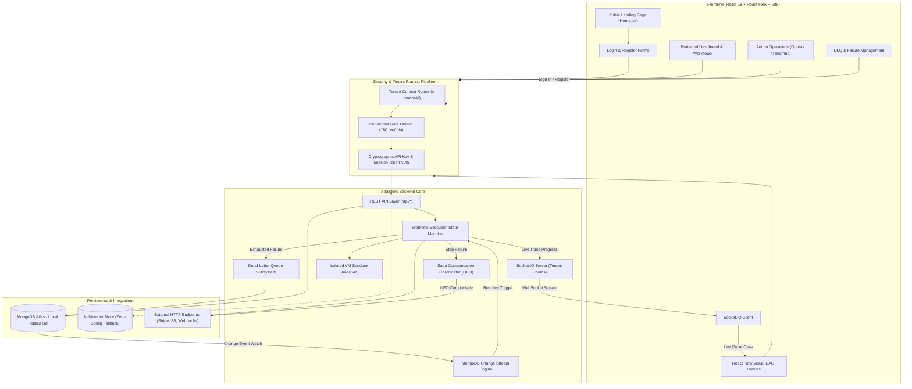

# Aegisflow — Multi-Tenant Distributed Workflow & Saga Orchestration Engine

[](https://nodejs.org/)
[](https://react.dev/)
[](https://vitejs.dev/)
[](https://expressjs.com/)
[](https://www.mongodb.com/)
[](https://socket.io/)
[](docker-compose.yml)
[](backend/test/)
[](stress-test.js)

**Aegisflow** is a resilient, multi-tenant distributed workflow automation and Saga orchestration platform designed to mirror enterprise orchestrators such as **Temporal** and **Zapier**. Built for mission-critical automation, it integrates a visual Directed Acyclic Graph (DAG) builder, an asynchronous execution state machine, distributed Saga compensation rollbacks, isolated JavaScript execution sandboxes, real-time WebSocket progress streaming, automated Dead-Letter Queue (DLQ) failure handling, and a reactive MongoDB Change Stream trigger engine.

---

## 🌟 Key Features & Architectural Highlights

### 1. Multi-Tenant Isolation & Workspace Partitioning
- **Strict Tenant Context Routing:** Every request requires an `x-tenant-id` header (e.g. `demo-tenant`, `globex-corp`, `stark-tech`, or custom workspace slugs).
- **Interactive Tenant Switcher:** Switch between enterprise workspaces (*Acme Ltd.*, *Globex Corp.*, *Stark Industries*) directly from the top navigation bar.
- **Tenant-Scoped Rate Limiting:** Enforces a sliding 60-second window rate limit of **180 requests/minute per tenant**, preventing cross-tenant noisy neighbor impact.
- **Data Isolation:** Workflows, execution histories, DLQ entries, and API keys are strictly partitioned at both the database and cache layers.

### 2. Public Visitor Experience & Authentication Guard
- **Public Showcase Interface:** Unauthenticated visitors landing on `http://localhost:5173/` view an interactive presentation of Aegisflow's architecture, benchmark throughput, and template cards without leaking private tenant metrics or backend database data.
- **Protected Workspace Access:** All private operations (`/dashboard`, `/workflows`, `/executions`, `/admin`, `/organization`) are safeguarded by session authentication and signed token verification.
- **User Authentication:** Built-in registration and login supporting email and phone numbers, salted scrypt password hashing, and signed HMAC-SHA256 session tokens.

### 3. Visual DAG Canvas & Topological Graph Validation
- **Interactive Canvas (@xyflow/react):** Drag-and-drop workflow canvas supporting Triggers (Webhooks/Events), Actions (HTTP dispatch, inventory, email), Conditions (dynamic branching), Transforms (sandboxed JS), and Saga Compensations.
- **Topological DAG Validation:** Depth-First Search (DFS) backend validation detects circular dependencies, infinite loops, missing targets, and orphaned or disconnected nodes prior to saving.

### 4. Distributed Saga Compensation Rollback (LIFO)
- **Automatic Failure Recovery:** When a downstream step encounters an unrecoverable failure (or exhausts retries), the Saga coordinator automatically reverses completed compensatable steps.
- **Strict Reverse Order (LIFO):** Compensations execute in exact inverse order of completion to avoid distributed data inconsistency (e.g. reversing warehouse stock reservations if payment authorization fails).
- **Granular Compensation Status:** Clear visual distinction between successful rollbacks (`Compensated`) and partial rollback failures (`Compensation Failed`).

### 5. Isolated JavaScript Transform Sandbox
- **Secure VM Isolation (`node:vm`):** Executes custom user data transformation scripts inside isolated execution contexts with strict CPU timeouts (**500ms max**) and memory constraints.
- **Sandbox Hardening:** Strips dangerous host globals (`process`, `require`, `fs`, `eval`, `child_process`) to prevent host environment tampering while allowing clean JSON input/output transformations.

### 6. Bidirectional WebSocket Execution Streaming
- **Real-Time Step Tracing:** Socket.IO engine streams live execution events directly to the browser across tenant-isolated rooms (`tenant:<id>`).
- **Visual Pulse Nodes:** Canvas nodes illuminate and animate dynamically during runs:
  - 🔵 **Blue Pulse:** Step currently running
  - 🟢 **Green:** Step completed successfully
  - 🔴 **Red:** Step failed
  - 🟠 **Orange Pulse:** Saga rollback in progress
  - 🟣 **Purple:** Step compensated

### 7. Dead-Letter Queue (DLQ) & Replay Engine
- **Automatic DLQ Routing:** Failed executions and exhausted retries are automatically routed to the Dead-Letter Queue collection.
- **DLQ Management Portal (`/failures`):** Inspect failed payload contexts, downstream error stacks, and retry counts, with one-click execution replay capabilities.

### 8. Reactive MongoDB Change Stream Trigger
- **Event-Driven Architecture:** Ingests document mutation events and reactively triggers matching active workflows in sub-milliseconds.
- **Standard Specification Payload:** Formats events following official MongoDB Change Stream specs (`_id._data` resume tokens, `operationType: 'insert'`, `clusterTime`, `wallTime`, `documentKey`, and `fullDocument`).
- **Hybrid Operation:** Supports live MongoDB replica set streaming (`collection.watch()`) and in-memory event adapter fallback.

### 9. Administrative Operations Dashboard (`/admin`)
- **Tenant Quotas:** Live progress monitors displaying per-tenant request consumption against the 180 req/min rate limit.
- **Worker Latency Charts:** Real-time line charts tracking average and p95 run duration across hourly buckets.
- **Failure Heatmap:** Interactive matrix highlighting failure frequencies grouped by workflow step and time.

### 10. Enterprise Dataset (50 Workflows & 168 Execution Traces)
- **Pre-Seeded Workflows:** 50 realistic enterprise workflows across 3 tenants:
  - **25 for Acme Ltd. (`demo-tenant`):** E-Commerce fulfillment, dunning, instant refund dispatch, fraud score branching, subscription recurring billing.
  - **15 for Globex Corp. (`globex-corp`):** Global ocean freight manifests, AML sanctions screening, FX currency hedging, cold-chain IoT temperature breach compensations.
  - **10 for Stark Industries (`stark-tech`):** Automated blue/green canary deployments, distributed LLM fine-tuning pipelines, zero-day auto-patching rollouts, telemetry ingestion.
- **168 Execution Records:** Rich execution histories containing real step logs, timings, and Saga rollbacks across MongoDB Atlas and the in-memory fallback store.

---

## 🏗️ System Architecture



---

## 📂 Project Structure

```text
Multi-Tenant-Distributed-Workflow/
├── backend/
│   ├── src/
│   │   ├── models/
│   │   │   ├── ApiKey.js         # Mongoose schema for cryptographic API keys
│   │   │   ├── Dlq.js            # Mongoose schema for Dead-Letter Queue records
│   │   │   ├── Event.js          # Mongoose schema for Change Stream events
│   │   │   ├── Execution.js      # Execution run history & step trace schema
│   │   │   ├── User.js           # User credentials & organization role schema
│   │   │   └── Workflow.js       # Workflow DAG & metadata schema
│   │   ├── auth.js               # Scrypt password hashing & HMAC session tokens
│   │   ├── change-stream.js      # MongoDB Change Stream reactive trigger engine
│   │   ├── sandbox.js            # Isolated node:vm transformation script sandbox
│   │   ├── seed-data.js          # 50 enterprise workflows & execution generator
│   │   ├── seed.js               # Database seeding script for MongoDB Atlas
│   │   ├── server.js             # Express API, Socket.IO server & security pipeline
│   │   └── workflow-engine.js    # DAG traversal, HTTP dispatch, retries, Saga rollback
│   ├── test/
│   │   ├── auth.test.js          # Password hashing, validation, session token tests
│   │   ├── change-stream.test.js # Change Stream reactive trigger unit tests
│   │   ├── sandbox-dlq.test.js   # Isolated VM sandbox & DLQ isolation tests
│   │   ├── security-tenancy.test.js # Multi-tenant isolation & API key tests
│   │   └── workflow-engine.test.js  # DAG DFS sort, branching, HTTP, Saga rollback tests
│   ├── .dockerignore             # Backend Docker build exclusion rules
│   ├── .env.example              # Environment variables template
│   ├── Dockerfile                # Production Node.js 20 Alpine backend container
│   └── package.json              # Backend dependencies and test scripts
├── src/
│   ├── components/
│   │   ├── Layout.jsx            # Shell with workspace switcher & public navigation
│   │   ├── Motion.jsx            # Dynamic reveal and SVG flow animations
│   │   └── UI.jsx                # Reusable design atoms (Buttons, Badges, Headers)
│   ├── pages/
│   │   ├── Admin.jsx             # Admin operations: tenant quotas, heatmap, latency
│   │   ├── Dashboard.jsx         # Live workspace metrics & activity charts
│   │   ├── ExecutionDetails.jsx  # Interactive step-by-step trace timeline & logs
│   │   ├── Executions.jsx        # Run history table, status filter & JSON export
│   │   ├── Failures.jsx          # Dead-Letter Queue (DLQ) inspection & replay
│   │   ├── Home.jsx              # Public landing page with benchmark showcase
│   │   ├── Integrations.jsx      # External connectors & webhook configurations
│   │   ├── Login.jsx             # User login portal (email / phone number)
│   │   ├── Organization.jsx      # API key generation & revocation management
│   │   ├── Register.jsx          # Account registration & organization onboarding
│   │   ├── Settings.jsx          # Tenant settings & preferences
│   │   ├── WorkflowBuilder.jsx   # Visual React Flow DAG canvas with live pulse
│   │   ├── Workflows.jsx         # Workflow catalog, triggers & status toggles
│   │   ├── admin.css             # Styling for Admin quota gauges and heatmap
│   │   ├── auth.css              # Authentication form styles
│   │   └── execution-trace.css   # Step trace timeline and log viewer styles
│   ├── services/
│   │   ├── api.js                # Resilient HTTP client with self-healing keys
│   │   ├── auth.js               # Client session state & token management
│   │   └── socket.js             # WebSocket manager for tenant rooms
│   ├── anim.css                  # UI animation keyframes
│   ├── App.jsx                   # React Router route definitions & auth guards
│   ├── main.jsx                  # React application entry point
│   ├── styles.css                # Base layout styles & component rules
│   └── theme.css                 # Color tokens, typography & dark theme system
├── .dockerignore                 # Root Docker build exclusion rules
├── .gitignore                    # Git file exclusion rules
├── docker-compose.yml            # Multi-container orchestration (Mongo, Backend, Frontend)
├── Dockerfile                    # Multi-stage production build for React UI + Nginx
├── index.html                    # Application HTML entry document
├── nginx.conf                    # Production Nginx reverse proxy configuration
├── package.json                  # Root dependencies and unified dev scripts
├── REPORT.md                     # Official Distributed Workflow & Saga Orchestration Report
├── stress-test.js                # 1,000+ concurrent distributed pipeline stress test
└── vite.config.js                # Vite configuration with API & WebSocket proxies
```

---

## 🚀 Getting Started

### Prerequisites
- **Node.js**: v20.0.0 or higher
- **npm**: v10.0.0 or higher
- *(Optional)* **Docker & Docker Compose** for containerized deployment

---

### 1. Installation

Clone the repository and install dependencies for both the frontend and backend:

```bash
# Clone the repository
git clone https://github.com/thoufiq3003/Multi-Tenant-Distributed-Workflow.git
cd Multi-Tenant-Distributed-Workflow

# Install frontend dependencies
npm install

# Install backend dependencies
npm install --prefix backend
```

---

### 2. Configuration (`backend/.env`)

Create a `.env` file in the `backend/` directory (or copy `backend/.env.example`):

```env
PORT=4000
CLIENT_ORIGIN=http://localhost:5173
MONGODB_URI=mongodb+srv://<username>:<password>@cluster0.nvl4bfv.mongodb.net/aegisflow?retryWrites=true&w=majority
API_KEY_PEPPER=aegisflow-secret-pepper-2026
```

> **Note:** If `MONGODB_URI` is not provided or the database is temporarily unreachable, Aegisflow seamlessly runs in **in-memory demo mode**, populated with all 50 workflows, executions, and demo keys.

---

### 3. Database Seeding (Optional)

To seed or refresh all **50 enterprise workflows**, **168 execution runs**, **6 DLQ records**, and the **demo user account** directly into your MongoDB Atlas cluster:

```bash
npm run seed --prefix backend
```

---

### 4. Running Locally

Start both the backend API (port 4000) and the Vite frontend (port 5173) concurrently with one command:

```bash
npm run dev:full
```

- **Frontend Application:** [http://localhost:5173](http://localhost:5173)
- **Backend Health Check:** [http://localhost:4000/api/health](http://localhost:4000/api/health)

*(Optional: Running in separate terminal windows)*
```bash
# Terminal 1 (Backend)
npm run dev --prefix backend

# Terminal 2 (Frontend)
npm run dev
```

---

### 5. Pre-Seeded Demo Credentials

#### Default User Login
- **Email:** `demo@aegisflow.dev`
- **Phone:** `9876543210`
- **Password:** `Password123!`
- **Role:** `Workflow admin` (Tenant: `demo-tenant` / Acme Ltd.)

*(You can also register a new account on `/register`).*

#### Pre-Seeded API Keys by Tenant
| Workspace | Tenant ID | Description | Pre-Seeded API Key |
|---|---|---|---|
| **Acme Ltd.** | `demo-tenant` | E-Commerce, Billing, Subscriptions (25 Workflows) | `fp_demo_7f8a9b0c1d2e3f4a5b6c7d8e` |
| **Globex Corp.** | `globex-corp` | Logistics, Ocean Freight, FX Hedging (15 Workflows) | `fp_globex_7f8a9b0c1d2e3f4a5b6c7d8e` |
| **Stark Industries** | `stark-tech` | Cloud-Native, Canary K8s, LLM Tuning (10 Workflows) | `fp_stark_7f8a9b0c1d2e3f4a5b6c7d8e` |

---

## 🧪 Testing & Verification

### Unit Test Suite
The project includes an automated test suite executed via the native Node.js test runner (`node --test`).

Run all 28 backend unit tests:
```bash
npm test --prefix backend
```

#### Test Coverage Summary
```text
TAP version 13
ok 1 - phone must be exactly 10 digits
ok 2 - email regex accepts proper emails only
ok 3 - registration validation reports each bad field
ok 4 - password hashing and tokens
ok 5 - createUser and findUser persist and retrieve user accounts
ok 6 - emitChangeEvent produces official MongoDB Change Stream payload structure
ok 7 - Change Stream reactively triggers matching workflow upon event insert
ok 8 - Change Stream does not trigger workflows of a different tenant
ok 9 - executeSandboxedScript transforms input payload safely
ok 10 - executeSandboxedScript terminates infinite loops cleanly via timeout
ok 11 - executeSandboxedScript restricts dangerous globals (process, require, fs)
ok 12 - workflow-engine executes transform node through isolated sandbox
ok 13 - Dead-Letter Queue (DLQ) captures failed executions
ok 14 - multi-tenant DLQ data isolation: Tenant A cannot see Tenant B DLQ
ok 15 - hashApiKey generates deterministic SHA-256 hash
ok 16 - createApiKey persists hashed key and returns plaintext key once
ok 17 - cross-tenant API key isolation: key from Tenant A cannot authenticate Tenant B
ok 18 - revoking API key prevents further authentication
ok 19 - multi-tenant workflow data isolation: tenant records remain separate
ok 20 - seeded default demo key validates for demo-tenant
ok 21 - valid DAG passes validation
ok 22 - cycle is detected
ok 23 - unreachable node is reported
ok 24 - executor follows configured branch and completes
ok 25 - executor retries simulated failure then fails
ok 26 - Saga rollback compensates completed compensatable steps in reverse order
ok 27 - execution reports compensation failure distinctly
ok 28 - executeWorkflow dispatches real HTTP call, records output, and streams progress
1..28
# tests 28 | pass 28 | fail 0
```

---

### 1,000+ Concurrent Pipeline Stress Test
Complies with the Zaalima Week 4 requirement for high-throughput orchestrator validation.

Run the stress test:
```bash
npm run stress-test
```

#### Benchmark Results
```text
======================================================================
  AEGISFLOW DISTRIBUTED ORCHESTRATOR — 1,000+ CONCURRENT STRESS TEST
======================================================================
 Target Pipelines   : 1,000
 Concurrency Pool   : 100 concurrent in-flight workers
 Multi-Tenant Pool  : demo-tenant, globex-corp, stark-tech, wayne-enterprises, cyberdyne-sys
 Pipeline Scenarios : Straight-line, Branching, Saga Rollback, Sandboxed JS
----------------------------------------------------------------------
 Total Pipelines Run    : 1,000
 Total Wall-Clock Time  : 0.40 seconds
 System Throughput      : 2,528.06 pipelines/second
----------------------------------------------------------------------
 STATUS BREAKDOWN
   ✓ Completed (Normal) : 750 (75.0%)
   ⟲ Compensated (Saga) : 250 (25.0%)
   ✖ Unhandled Failures : 0 (0.0%)
----------------------------------------------------------------------
 LATENCY DISTRIBUTION
   Min Latency          : 0.03 ms
   Average (Mean)       : 35.84 ms
   Median (P50)         : 4.97 ms
   P95 Latency          : 148.96 ms
   Max Latency          : 152.06 ms
----------------------------------------------------------------------
 VERDICT: PASSED ☑ (Orchestrator sustained 1,000+ distributed pipelines)
======================================================================
```

---

### Frontend Build Verification
Verify that the production Vite React build bundles cleanly without errors:
```bash
npm run build
```

---

## 🐳 Docker Containerization & Cloud Deployment

Aegisflow is fully containerized with multi-stage production builds and single-command orchestration.

### Quick Start with Docker Compose
To build and launch the complete stack (MongoDB, Backend Orchestrator, and Nginx React Frontend):

```bash
docker compose up --build
```

### Services Architecture
| Service | Container Name | Port | Description |
|---|---|---|---|
| **Frontend** | `aegisflow-frontend` | `80`, `5173` | Production Nginx server with SPA fallback and API reverse proxy |
| **Backend** | `aegisflow-backend` | `4000` | Node.js Saga engine, WebSocket server, and Change Stream worker |
| **MongoDB** | `aegisflow-mongodb` | `27017` | Persistent document database with replica set & health check |

### Cloud Auto-Scaling & Kubernetes Architecture
For production cloud deployment (AWS ECS / EKS / GCP GKE):
- **Stateless Backend Nodes:** Backend pods can be horizontally scaled (`HorizontalPodAutoscaler` based on CPU/RAM or queue depth).
- **Socket.IO Redis Adapter:** When scaling backend pods across nodes, configure `@socket.io/redis-adapter` to distribute WebSocket events across instances.
- **Worker Thread Sandboxing:** Each pod executes transformation scripts inside bounded `node:vm` sandboxes with strict CPU timeouts (500ms max) and memory restrictions.
- **MongoDB Atlas Connection:** Override `MONGODB_URI` in container environment variables to target cloud-managed clusters.

---

## 📡 API Reference Overview

All data endpoints require the `x-tenant-id` header (defaults to `demo-tenant`) and validate the `x-api-key` header or signed session token.

### Authentication & Users
| Method | Endpoint | Description |
|---|---|---|
| `POST` | `/api/auth/register` | Register a new user account and organization |
| `POST` | `/api/auth/login` | Authenticate using email or phone number and password |
| `GET` | `/api/auth/me` | Retrieve authenticated user profile via session token |

### Workflows
| Method | Endpoint | Description |
|---|---|---|
| `GET` | `/api/workflows` | List all workflows for the active tenant |
| `POST` | `/api/workflows` | Create a new workflow DAG |
| `GET` | `/api/workflows/:id` | Retrieve workflow by ID |
| `PUT` | `/api/workflows/:id` | Update an existing workflow DAG |
| `DELETE` | `/api/workflows/:id` | Delete a workflow |
| `POST` | `/api/workflows/validate` | Validate nodes and edges (cycles, orphans) |
| `PATCH` | `/api/workflows/:id/status` | Update workflow status (`Active` / `Paused`) |

### Executions & Saga Orchestration
| Method | Endpoint | Description |
|---|---|---|
| `GET` | `/api/executions` | List executions for the tenant |
| `GET` | `/api/executions/:id` | Get execution details and step logs |
| `POST` | `/api/workflows/:id/execute` | Execute a workflow with optional payload |
| `POST` | `/api/executions/:id/retry` | Re-run a previous execution |

### Dead-Letter Queue (DLQ)
| Method | Endpoint | Description |
|---|---|---|
| `GET` | `/api/dlq` | List dead-letter queue records for the tenant |
| `GET` | `/api/dlq/:id` | Get DLQ item details and payload |
| `POST` | `/api/dlq/:id/replay` | Replay a failed DLQ execution |
| `DELETE` | `/api/dlq/:id` | Dismiss/delete a DLQ item |

### Admin Operations & Metrics
| Method | Endpoint | Description |
|---|---|---|
| `GET` | `/api/metrics` | Retrieve workspace stats (workflow count, completed, failed) |
| `GET` | `/api/admin/overview` | Platform admin stats: tenant quotas, latency, failure heatmap |

### API Key Management
| Method | Endpoint | Description |
|---|---|---|
| `GET` | `/api/api-keys` | List active keys (masked preview) |
| `POST` | `/api/api-keys` | Generate a new cryptographically hashed key |
| `DELETE` | `/api/api-keys/:id` | Revoke an API key immediately |

### MongoDB Change Stream & Events
| Method | Endpoint | Description |
|---|---|---|
| `GET` | `/api/events` | List recorded change stream events |
| `POST` | `/api/events` | Ingest an event and reactively fire matching workflows |

---

## 🎯 Step-by-Step Demonstration Guide

Follow these steps to demonstrate the engine's core capabilities:

1. **Public Exploration (No Authentication Required):**
   - Open `http://localhost:5173`.
   - Observe that the landing page showcases platform features, architectural benchmarks, and templates with **zero private data leakage**.
2. **User Authentication:**
   - Click **Sign in** in the top navigation bar.
   - Log in using `demo@aegisflow.dev` / `Password123!` (or create a new account).
   - Once authenticated, you will be directed to your tenant workspace.
3. **Workspace Switching (Multi-Tenancy):**
   - Click the workspace dropdown in the header (*Acme Ltd.*).
   - Select **Globex Corp.** (15 workflows) or **Stark Industries** (10 workflows).
   - Observe that workflows, executions, and metrics update immediately in full isolation.
4. **Visual DAG Execution & Live WebSocket Streaming:**
   - Go to **Workflows** (`/workflows`) and edit **Order Processing** (or any active workflow).
   - Click **"Run test"**.
   - Watch the nodes pulse blue as they execute, turn green upon completion, and stream live progress above the canvas.
5. **Saga Compensation Rollback:**
   - In the workflow builder, select a workflow with a compensatable node followed by a step configured to fail.
   - Run the workflow and observe the engine automatically execute backward compensation in reverse order (LIFO).
6. **Dead-Letter Queue (DLQ) & Failure Recovery:**
   - Navigate to **Operations** > **Dead-Letter Queue** (`/failures`).
   - Inspect captured dead executions, failure error messages, and payload contexts.
   - Click **Replay** to re-dispatch the failed execution.
7. **Platform Admin Monitoring (`/admin`):**
   - Navigate to **Operations** > **Admin Monitoring** (`/admin`).
   - View live tenant quota utilization gauges, hourly worker latency curves, and the step failure heatmap.
8. **MongoDB Change Stream Reactive Trigger:**
   - Open a terminal and emit an event document:
     ```powershell
     Invoke-RestMethod -Uri "http://localhost:4000/api/events" -Method POST -Headers @{ "x-tenant-id" = "demo-tenant"; "Content-Type" = "application/json" } -Body '{"eventType":"order.created","payload":{"orderId":"ORD-500"}}'
     ```
   - Watch the matching active workflow trigger reactively in the UI without clicking "Run test".

---

## 📄 Formal Documentation & Submission Report

For the complete technical breakdown and formal evaluation report, please refer to:
- [`REPORT.md`](REPORT.md) — **Distributed Workflow & Saga Orchestration Report** (Zaalima Final Deliverable).

---

## ⚖️ License

This project was developed for the **Zaalima Internship Program** as an enterprise demonstration of distributed systems, Saga orchestration, and multi-tenant cloud architectures.
